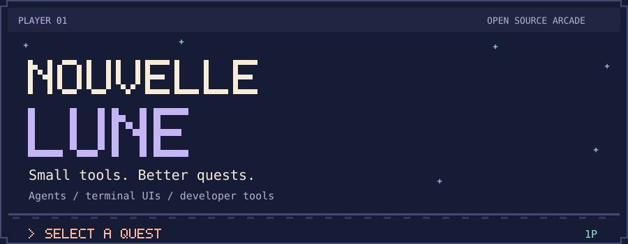
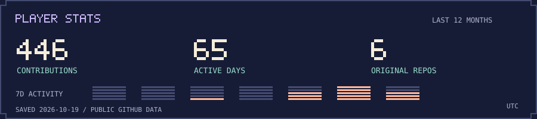
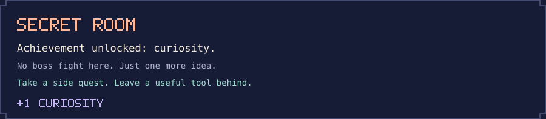

<p align="center">
  <a href="#select-a-quest">
    <picture>
      <source media="(max-width: 600px)" srcset="assets/arcade-mobile.svg">
      
    </picture>
  </a>
</p>

<p align="center">
  I build tools for coding agents and the people working with them.<br>
  Mostly TypeScript, terminal interfaces, and the little details that make a workflow feel good.
</p>

<p align="center">
  <a href="#select-a-quest">Select a quest</a> &nbsp;·&nbsp;
  <a href="#bonus-stage">Bonus stage</a> &nbsp;·&nbsp;
  <a href="https://github.com/Nouvelle-Lune?tab=repositories">All repositories</a>
</p>

<br>

## Select a quest

Two tools from my inventory. Pick one and have a look around.

<table>
  <tr>
    <td valign="top" width="50%">
      <h3><a href="https://github.com/Nouvelle-Lune/lune-pi">Lune for Pi</a></h3>
      <p>A calmer terminal workspace for your coding agent. Compact tool cards, structured questions, background shells, and session recaps.</p>
      <p><code>TypeScript</code> <code>Pi extensions</code> <code>Terminal UI</code></p>
      <p><a href="https://github.com/Nouvelle-Lune/lune-pi#quick-start">Enter the workspace →</a></p>
    </td>
    <td valign="top" width="50%">
      <h3><a href="https://github.com/Nouvelle-Lune/git-commit-genie">Git Commit Genie</a></h3>
      <p>Turn staged changes into a commit message with context. Repository-aware analysis, custom templates, and a message you can review before committing.</p>
      <p><code>TypeScript</code> <code>VS Code</code> <code>AI tooling</code></p>
      <p><a href="https://marketplace.visualstudio.com/items?itemName=Lune-99.git-commit-genie">Summon the genie →</a></p>
    </td>
  </tr>
</table>

<details>
<summary><b>Open the side-quest inventory</b></summary>

<br>

| Item | What it does |
| :--- | :--- |
| [Shell Inspector](https://github.com/Nouvelle-Lune/lune-shell-inspector) | Keep background jobs in view, inspect their output, and get the result back to the agent. |
| [Ask Question](https://github.com/Nouvelle-Lune/lune-ask-question) | Give the agent a structured way to ask, with choices and room for your own answer. |
| [Pi BTW](https://github.com/Nouvelle-Lune/pi-btw-cc) | Ask a quick side question in a floating overlay without losing the main conversation. |

</details>

<br>

## Save file

<picture>
  <source media="(max-width: 600px)" srcset="assets/player-stats-mobile.svg">
  
</picture>

<sub>Real GitHub data, refreshed daily. Contributions and active days cover the last 12 months. Original repos exclude forks.</sub>

<br>

## Bonus stage

Every contribution leaves a pixel. The snake takes care of the rest.

<picture>
  <source media="(prefers-color-scheme: dark)" srcset="assets/snake-dark.svg">
  <source media="(prefers-color-scheme: light)" srcset="assets/snake.svg">
  
</picture>

<sub>Animation by <a href="https://github.com/Platane/snk">Platane/snk</a>. This stage plays itself.</sub>

<br>

<details>
<summary><code>↑ ↑ ↓ ↓ ← → ← → B A</code> &nbsp; Something is hidden here...</summary>

<br>

<picture>
  <source media="(max-width: 600px)" srcset="assets/secret-room-mobile.svg">
  
</picture>

You found the quiet corner of the arcade. Your reward: [a tiny side-question tool](https://github.com/Nouvelle-Lune/pi-btw-cc) for when the main quest can wait a minute.

```text
ACHIEVEMENT UNLOCKED
[+] Looked beyond the README.
[+] Found a shortcut to a side quest.
[+] Probably has one more idea for a project.
```

</details>

<br>

<p align="center"><sub>Thanks for stopping by. Player two is always welcome.</sub></p>
