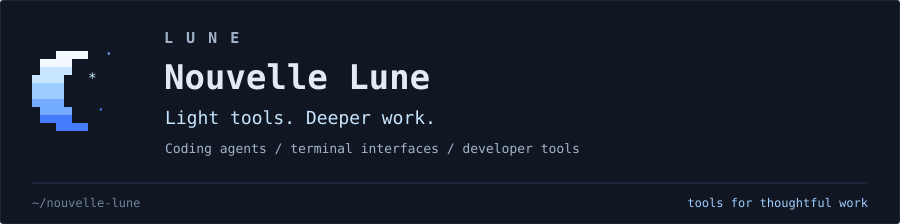
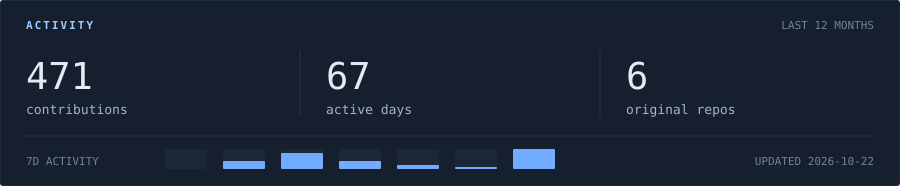
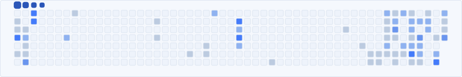

  <a href="https://github.com/Nouvelle-Lune?tab=repositories">
    <picture>
      <source media="(max-width: 600px)" srcset="assets/lune-header-mobile.svg">
      
    </picture>
  </a>

  I build tools for coding agents and the people working with them. 
  TypeScript, terminal interfaces, and thoughtful workflows.

  <a href="#activity">Activity</a> &nbsp;·&nbsp;
  <a href="#contribution-trail">Contribution trail</a> &nbsp;·&nbsp;
  <a href="https://github.com/Nouvelle-Lune?tab=repositories">Repositories</a>

 

## Activity

<picture>
  <source media="(max-width: 600px)" srcset="assets/activity-mobile.svg">
  
</picture>

Real GitHub data, refreshed daily. Contributions and active days cover the last 12 months. Original repos exclude forks.

 

## Contribution trail

Every contribution leaves a trace.

<picture>
  <source media="(prefers-color-scheme: dark)" srcset="assets/contributions-dark.svg">
  <source media="(prefers-color-scheme: light)" srcset="assets/contributions.svg">
  
</picture>

 

Thanks for stopping by.

